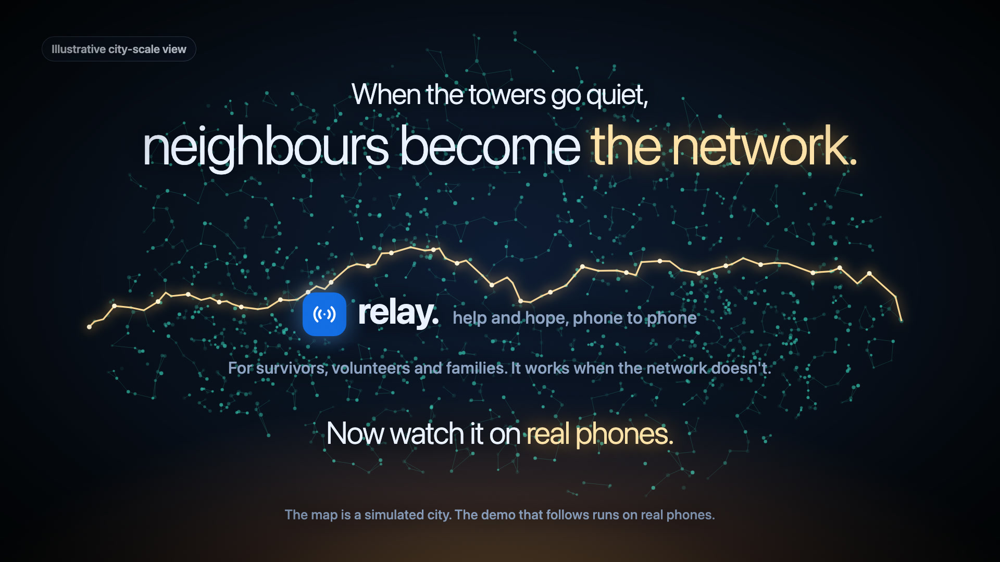
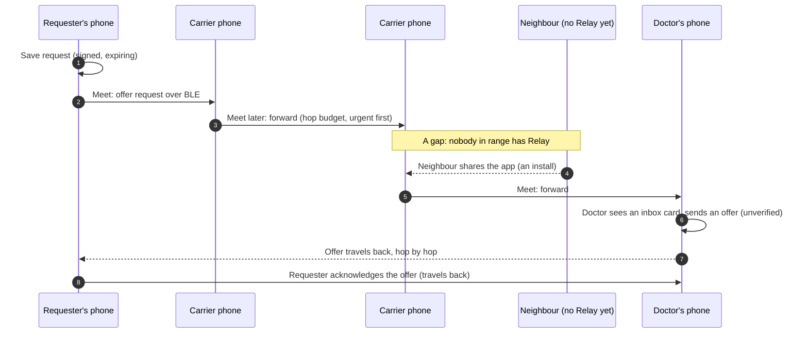
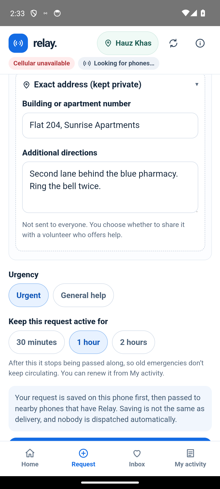
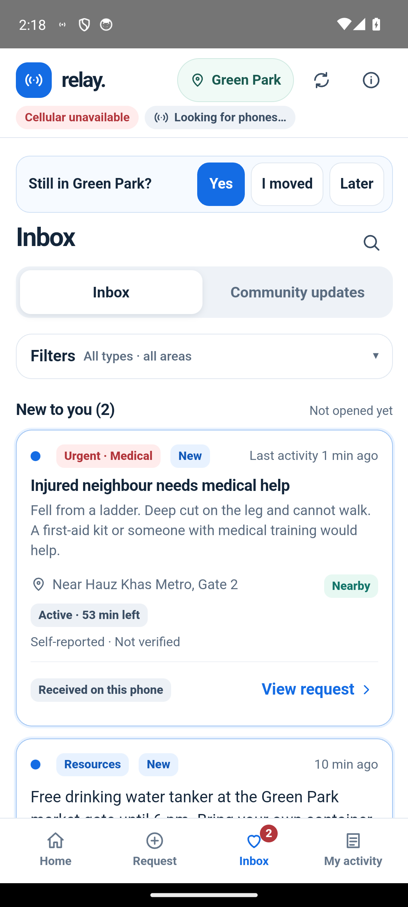
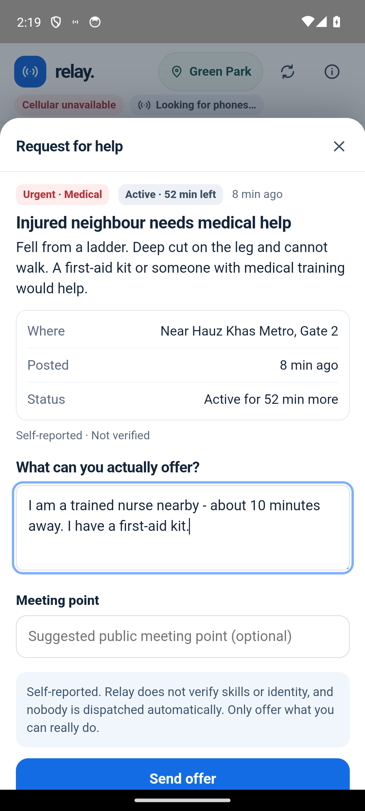
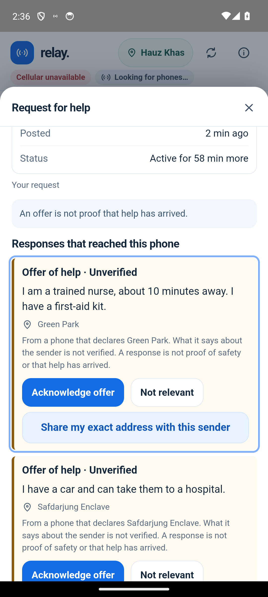
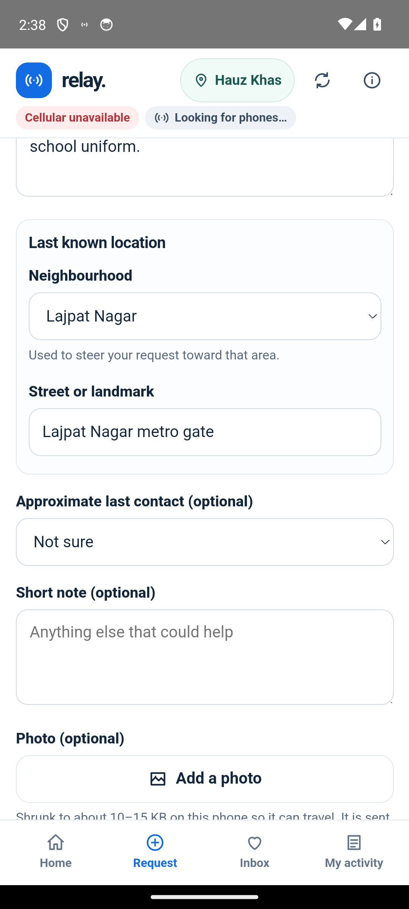
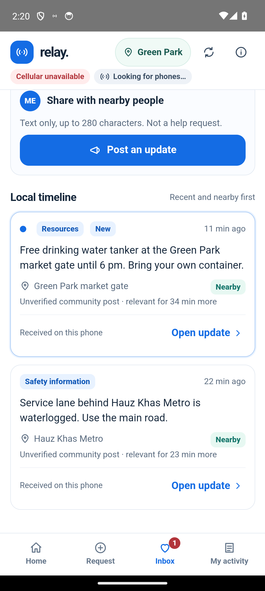

<div align="center">

# Relay

**Help that travels phone to phone, for the day after the Snap.**

An offline-first community help network for Android. Nearby phones carry urgent requests, missing-person reports and local updates to the people who can answer them, over Bluetooth, with no cell service, internet, server, account or GPS.

[](docs/media/relay-explainer-65s.mp4)

*Click the poster for the 65-second explainer ([`docs/media/relay-explainer-65s.mp4`](docs/media/relay-explainer-65s.mp4)). The map in it is a simulation; the phone screens are the real app.*

</div>

> **For reviewers (Flipkart APM '29 case, Prompt 2).** Read [Why we are building this](#why-we-are-building-this-the-day-after-the-snap) and [What Relay is](#what-relay-is). Then open the prototype in two clicks ([quick start](#quick-start)). The as-built product requirements document is in [`docs/appendix-prd/`](docs/appendix-prd/Relay_Complete_PRD_Appendix.pdf). A separate section, [Honest status](#honest-status-what-is-proven-and-what-is-not), says exactly what is tested and what is only reported.

---

## Contents

1. [Why we are building this: the day after the Snap](#why-we-are-building-this-the-day-after-the-snap)
2. [What Relay is](#what-relay-is)
3. [Who it is for](#who-it-is-for)
4. [The story in about a minute](#the-story-in-about-a-minute)
5. [How it works](#how-it-works)
6. [Features](#features)
7. [Screens](#screens)
8. [Honest status: what is proven and what is not](#honest-status-what-is-proven-and-what-is-not)
9. [How we would know it works](#how-we-would-know-it-works)
10. [Security and privacy](#security-and-privacy)
11. [Quick start](#quick-start)
12. [Repository map](#repository-map)
13. [Limitations and roadmap](#limitations-and-roadmap)
14. [Licence and credits](#licence-and-credits)

---

## Why we are building this: the day after the Snap

**The brief.** *It is 2018 and the Battle of Wakanda has just ended. Thanos snaps his fingers and 50% of the population is gone in an instant. Build a digital product for this new world, as on the day after the Snap.*

Most answers to a prompt like this start with grief, governance or supply chains. We started with a more mechanical question: **what stops working, first, for the people who are still here?**

### What breaks first

**The communication systems.** In the world we designed for, the Snap does not only remove half the people. It also fires a **heavy electromagnetic pulse (EMP)**. That is our premise: overnight, **the communication systems are gone**. Cell towers and base stations, the routers and switches behind them, the data-centre equipment and the grid-tied hardware that powers them are large installations wired together with long cables, and long conductors are exactly where a strong pulse couples in and burns out electronics. No cellular service. No internet. No servers.

**And nobody can quickly repair it.** "The network" was never one thing; it is a chain of people-run systems: the power stations and the crews that keep them running, the technicians who maintain towers and fibre, the engineers behind data centres, the support desks that restore a failed link. Half of those people are gone. Every chain has lost links it cannot quickly replace, so the outage is not a bad weekend; it is open-ended.

**What still works: the phone in your pocket.** We assume handsets survived, with charged batteries and working short-range radios (Bluetooth). We state this as the premise of the story, not as an engineering claim. The reasoning is that a pulse hurts large systems with long conductors most, and a pocket-sized battery device with a tiny internal antenna is far less exposed; and, more simply, that if the handsets were dead there would be nothing for any digital product to run on. Everything Relay does starts from that one surviving thing.

So we made the explicit assumptions the case allows:

| We assume | We do **not** assume |
|---|---|
| Survivors still have charged smartphones (the pulse spared handsets) | Cellular service (the EMP took the towers) |
| Short-range radios (Bluetooth) still work | Internet or any server (the EMP took the data centres) |
| People are physically close to one another, in neighbourhoods | GPS or satellite positioning |
| Some people are willing to help a stranger | Accounts, phone numbers, or knowing whom to call |
| Nobody is coming to repair the network soon (half the repair crews are gone) | Any official dispatch or help line |

### What happens the day after

Three things happen at once.

1. **Urgent needs spike while half the helpers are gone.** Medical emergencies, rescue, food, water, shelter. The doctor, the nurse, the person with a boat: some of them are still here, but you do not know which stranger nearby they are.
2. **Everyone is looking for someone.** Half of every family, school class and friend group is missing. "Where is my child?" is not a rare request; it is the most common one. A missing-person report has to travel to the neighbourhood where the person might be, and a possible sighting has to travel back.
3. **Information vanishes.** Where is the water? Which shelter is open? Which road is safe? These are small, useful, short-lived facts, and nobody can broadcast them any more.

### Why the tools we already have fail

* **Messaging apps** need a server, and you need to know *whom* to message. The person who needs help does not know who can help.
* **Maps and search** need servers.
* **Social media** needs the internet, and turns urgent needs into noise.
* **Single-hop Bluetooth chat** fails the moment the right person is two streets away and not in range.

The failure is not "there is no chat box". It is that **a need cannot reach an unknown helper when the infrastructure that used to connect them is gone.**

### The insight

> **Carry needs, not conversations.**

If every phone that has Relay keeps a short, structured, expiring request and passes it on whenever it meets another phone, a need can cross a neighbourhood without anyone knowing the route in advance, the way a message passed hand to hand through a crowd does. The person who can help, whoever and wherever they are, will eventually be a phone that has the message. They answer; the answer travels back the same way; the requester acknowledges. Each step is honest about what it does and does not prove.

### The Snap is a stress test, not the only use

The same failure happens, at smaller scale, in floods, earthquakes, cyclones, long blackouts and conflict zones: towers lose power, backhaul breaks, and neighbours who are physically close cannot reach one another. If a product works on the day after the Snap, it works on the night of a flood. That is the real reason to build it, and it is why we kept the design deliberately small: it has to run on an ordinary phone, on a low battery, with nothing else.

### What we chose not to build

Not a general chat app. Not an emergency-dispatch system. No volunteer verification (every offer and sighting is labelled **unverified**). No citywide live map. No GPS, internet, accounts or phone numbers. Relay never says "rescued", "found" or "delivered" unless the evidence on that phone supports it.

*Why this prompt and not the other:* two case prompts were explored. We chose this one because it offered a narrow, demonstrable failure mechanism (a message cannot reach an unknown helper without infrastructure) over a more speculative idea. That is our judgement of the case, not a claim that we scored the alternatives. The alternatives we compared for this problem (offline chat, single-hop Bluetooth, device trackers, community walls, formal dispatch, citywide routing) and why each is not the centre of Relay are in [`docs/appendix-prd/`](docs/appendix-prd/Relay_Complete_PRD_Appendix.pdf), section 2.

---

## What Relay is

**Relay lets nearby Android phones pass urgent help requests, missing-person reports and useful neighbourhood updates without cellular service, internet, servers or GPS.** People can offer help, the requester can acknowledge an offer, and every message keeps moving as phones meet other phones.

Three principles shape every screen:

1. **Carry needs, not conversations.** Structured, expiring requests with a reply path beat chat threads, because the eventual helper is unknown.
2. **Never claim more than is known.** *Saved on this phone*, *shared with a nearby phone*, *received*, *opened*, *acknowledged* and *resolved* are different facts, and none of them means help arrived. Opening a message only marks it read on that phone; nobody is told.
3. **Spend scarce resources by urgency.** Urgent text outranks community updates and photos. Every copy is bounded by hops, fan-out and lifetime, so Relay does not flood a battery or a radio.

---

## Who it is for

| Person | What they need | What Relay gives them |
|---|---|---|
| **Someone who needs urgent help** | Make a need discoverable without knowing anyone's number | An urgent request that travels through nearby phones |
| **Someone looking for a person** | Get a description, a last-known place and a photo to people who might have seen them | A missing-person report steered toward the right neighbourhoods; unverified sightings coming back |
| **A potential helper** (doctor, nurse, neighbour) | See requests that genuinely reached their phone and offer help without publishing a home address | A prioritised inbox, an offer form, and an exact address shared with **one** chosen responder only |
| **A community contributor** | Post a short, useful, expiring update without crowding out emergencies | Community updates that travel at low priority |
| **An incidental carrier** | Help without doing anything | A phone that carries messages for others even if its owner never answers one |

---

## The story in about a minute

This is the story the [explainer video](docs/media/relay-explainer-65s.mp4) tells, using the real app and the simulator.

1. **No signal.** A disaster has taken the network down. A woman is having a heart attack. A bystander opens Relay and, with one tap, saves an urgent request on their phone. It says *Saved on this phone* first, and only then offers it to nearby phones.
2. **Phone to phone.** The request hops between phones. In the simulator it spreads across a city of about 12,600 simulated phones (one dot stands for about 200; this is stated on screen).
3. **A gap.** It stalls: nobody in the middle has Relay. A neighbour shares the app, the link is made, and the request crosses.
4. **A doctor answers.** A clinic doctor in another neighbourhood sees it as an inbox card and sends an offer, labelled unverified. It travels home.
5. **Someone is coming.** The requester acknowledges the offer, and the doctor's phone receives the acknowledgement. (Acknowledgement does not confirm anyone has been helped, and the app says so.)
6. **Missing person.** A parent adds a photo and a last-known place. Every phone becomes a pair of eyes; a possible sighting comes back, unverified.
7. **Community updates.** One update, on every nearby phone: where the water is, where shelter is, which roads are safe.

---

## How it works

Relay is **not** a Bluetooth SIG Mesh product. It is its own application-level **store-carry-forward** protocol over Bluetooth Low Energy, built on a well-studied idea (delay-tolerant networking): a phone that cannot reach the destination *keeps* the message and hands it on when it meets another phone.



**What each phone does**

* **Stores** every valid message it receives in a local SQLite database, so it survives app close and reboot.
* **Forwards** a message whenever it meets a phone that does not have it, respecting hop, copy and lifetime limits. Duplicates are recognised by the packet ID (a SHA-256 of the signed body) and dropped.
* **Prioritises** by urgency: urgent requests first, other requests next, community updates and photos last.
* **Expires** everything. Requests live for a chosen time (urgent 30, 60 or 120 minutes; missing-person reports up to 24 hours). Nothing is kept forever.

**Routing differs by what the message is**

| Message | Strategy | Why |
|---|---|---|
| Urgent or general request | Broad forwarding (flood), up to 60 hops, urgent first | You cannot know where the doctor is |
| Missing-person report | Directed toward the neighbourhoods the person might be in, with a few copies and bounded detours | Search where it matters, not everywhere |
| Community update | Low priority, shorter lifetime, up to 30 hops | Useful but never at the expense of emergencies |
| Replies, acknowledgements, resolutions | Flood back to the requester | The requester's area may be stale |

**Location without GPS.** People declare one of ten illustrative Delhi neighbourhoods (Hauz Khas, Green Park, Lajpat Nagar and others). The app asks every 30 minutes whether they are still there; an unconfirmed area stops being trusted for routing after 60 minutes. Directed routing uses a small neighbourhood graph, not coordinates.

**The Android app** is a Kotlin Bluetooth LE engine (every phone is a GATT server and scanner, with a foreground service), a SQLite store, and a bundled WebView interface that is the **same UI code** as the browser prototype. It requests no `INTERNET` permission. Details: [`docs/architecture/ARCHITECTURE.md`](docs/architecture/ARCHITECTURE.md) and [`docs/architecture/TRANSPORT_ADR.md`](docs/architecture/TRANSPORT_ADR.md).

---

## Features

| Area | What it does |
|---|---|
| **Urgent request** | Category, description, landmark and neighbourhood, optional private exact address, lifetime. Saved first, then shared. |
| **Find someone** | Name, description, last-known place and time, optional photo (shrunk to about 10 to 15 KB on the phone so it can travel), steered toward target neighbourhoods. |
| **Offer, sighting, acknowledgement** | Helpers offer help; people who saw someone share a *possible sighting*. The requester acknowledges. Everything is labelled **unverified**. |
| **Exact address, privately** | Never placed in a broadcast. Encrypted to **one** chosen responder's key; carriers cannot read it. |
| **Community updates** | Short, expiring, low-priority local information. |
| **Smart inbox** | *New to you*, *Active help requests*, *Community updates*, *Earlier messages*. Open and urgent items outrank expired ones; every message appears once. |
| **Search** | Local only: title, description, area, category and the text of responses. Finds earlier and expired messages that are still stored. |
| **Read state** | Durable per message, local to the phone. A new response to an old request makes it need attention again. |
| **Notifications** | In-app pop-ups only for **important** messages (a response to your request, an acknowledgement of your offer, an urgent or missing-person request in or next to your area). Android notifications when the app is closed: one message gets its own notification; two or more fold into a single "N new messages" notification. |
| **Refresh** | Re-reads the phone's own database and asks Bluetooth to look for nearby phones. Never claims to fetch from the internet. |
| **Honest status** | Distinct words: saved, shared, received, opened, acknowledged, resolved. |
| **Browser simulator** | A desktop network simulator of 80 phones in six neighbourhoods that explains the routing visually, using the same engine rules. |

Full detail on the inbox, search and notification design (including which messages are allowed to interrupt, and why): [`docs/android/INBOX_AND_NOTIFICATIONS.md`](docs/android/INBOX_AND_NOTIFICATIONS.md).

---

## Screens

Real captures of the as-built app. Where data was staged to reach a state, the captions in the [PRD appendix](docs/appendix-prd/Relay_Complete_PRD_Appendix.pdf) say so.

| | | |
|:--:|:--:|:--:|
| <br>**1. Create an urgent request** | <br>**2. Smart inbox** | <br>**3. A helper sees it and offers** |
| <br>**4. Reply and acknowledgement** | <br>**5. Find someone, with a photo** | <br>**6. Community update** |

More screenshots, including the inbox, search, pop-up and notification states, are in [`docs/screenshots/`](docs/screenshots/).

---

## Honest status: what is proven and what is not

We would rather say less and have it be true.

| Level | What exists |
|---|---|
| **Implemented** | The browser simulation (engine, app, desktop simulator) and the Android app described above, at the latest commit. |
| **Tested (automated)** | 108 Kotlin JVM tests; 28 emulator instrumented tests on Android 14 (0 failed, 1 manual fixture skipped by design); the browser engine suites (63 and 75 checks), an independent audit script set (28 of 28), the simulator suite (73), and Android-UI and inbox browser suites at 320, 360, 390, 412 and 768 px wide. |
| **Team-reported** | The team reports that the app has worked on **physical Android phones** over Bluetooth. The number of phones, models, settings, timings and logs are **not yet on record**. A [field-test protocol](docs/android/FIELD_TEST_CHECKLIST.md) with a result sheet exists to record them. |
| **Not yet demonstrated** | Three-phone multi-hop on real radios; mixed phone brands; background and battery behaviour; photo transfer over the radio; city-scale density; user research. |

Two things to keep in mind when reading the numbers and visuals:

* **The simulator is a simulation.** It uses no Bluetooth. It exists to explain and test routing. The "12,600 phones" in the video is a labelled scale (one dot is about 200 phones), not a measurement.
* **Earlier documents** ([`docs/architecture/LIMITATIONS.md`](docs/architecture/LIMITATIONS.md), [`docs/quality/QA_REPORT.md`](docs/quality/QA_REPORT.md)) were written before the team's physical-phone testing and still say no physical radio testing had been done. Both are kept as written, dated, and recorded in the evidence ladder above.

---

## How we would know it works

None of these are measured yet. They are the measures we propose, in order of importance.

| Layer | Measure |
|---|---|
| **North star** | The share of time-critical requests that get a **relevant, acknowledged response** in an acceptable window, by need type (the window needs research; it is not "rescue") |
| Delivery | Multi-hop delivery in controlled tests; time to first relevant receipt; copies and bytes per helper reached |
| Human engagement | Share of received urgent requests that are opened; time to first relevant response; share of responses acknowledged; share of users who can find an earlier message |
| Technical reliability | Successful phone-to-phone exchanges; connection success by phone model; battery use per hour |

**Our riskiest assumptions** (and how we would test them): enough phones meet before a request expires (density trials with 3, 5 and 10 or more phones); a relevant person chooses to answer (a small volunteer study); people keep Relay running despite the battery cost; people read *saved*, *shared*, *offer* and *acknowledged* as four different things (comprehension tests of the wording). The full assumption register is in the PRD appendix, section 11.

---

## Security and privacy

**Not independently reviewed. Do not call it "secure" or "private" without that qualification.**

* Every packet is **Ed25519-signed**; its ID is the SHA-256 of the signed body, so tampering is detected.
* Only the key holder can create, renew, acknowledge or resolve a case.
* An **exact address** is encrypted to one chosen responder (X25519, HKDF-SHA256, AES-256-GCM); carrying phones cannot read it.
* Identity keys are wrapped by the Android Keystore; cloud backup is disabled; **no `INTERNET` permission**.
* Rate limits (30 packets per hour per origin), size limits, hop limits and a storage cap bound abuse.

**What is not protected:** request text, photos, neighbourhoods and community posts are **not encrypted**; any phone that carries a packet can read it. Phones are pseudonymous, not anonymous. Volunteer claims are self-reported. See [`docs/architecture/SECURITY.md`](docs/architecture/SECURITY.md) for the full model and its gaps.

---

## Quick start

### 1. Try the prototype (two clicks, no install, no internet)

Open these files directly in Chrome:

* [`prototype/index.html`](prototype/index.html): the Relay mobile app. Best at about 390 px wide (use the browser's device toolbar). Walkthrough: [`docs/prototype/DEMO_INSTRUCTIONS.txt`](docs/prototype/DEMO_INSTRUCTIONS.txt).
* [`prototype/simulator.html`](prototype/simulator.html): the network simulator, for a laptop screen (1280 px or wider). Pick a scenario and press **Play**.

To package only the runnable HTML, CSS and JS as a zip (for example for a submission that allows only those file types):

```bash
scripts/package_prototype.sh "<your name>_<your college>"     # writes dist/<name>.zip
```

### 2. Run the tests

```bash
tests/run_engine.sh                    # Node: engine regression suites
tests/run_independent_audit.sh         # Node: the independent audit scripts
tests/run_sim.sh 1440 860              # headless Chrome: simulator suite
tests/run_app22.sh 390 844             # headless Chrome: browser-app suite
tests/run_android_inbox.sh 390 844     # headless Chrome: inbox, search, notifications (real-engine fixtures)
tests/run_android_ui.sh 390 844        # headless Chrome: the Android web UI adapter
```

Needs Node 18 or newer and Google Chrome. No dependencies to install.

```bash
cd android && ./gradlew :app:testDebugUnitTest            # Kotlin JVM tests
cd android && ./gradlew :app:connectedDebugAndroidTest    # emulator or device
```

### 3. Build and install the Android app

Follow [`docs/android/BUILD.md`](docs/android/BUILD.md) (requirements, signing, APK checks) and [`docs/android/INSTALL_AND_TEST.md`](docs/android/INSTALL_AND_TEST.md) (installing on phones, including sharing the APK from one phone to another). To test on real phones, use [`docs/android/FIELD_TEST_CHECKLIST.md`](docs/android/FIELD_TEST_CHECKLIST.md) and record the results.

---

## Repository map

```
relay/
├── README.md                    You are here
├── prototype/                   Runnable browser prototype: HTML, CSS, JS only
│   ├── index.html, app.js, style.css        The Relay app (also bundled into the Android app)
│   ├── simulator.html, sim.js, sim.css      The desktop network simulator
│   └── mesh.js                              The routing engine used by both
├── android/                     The Android app (Kotlin, SQLite, bundled WebView UI)
│   └── app/src/{main,test,androidTest,sharedTest}
├── tests/                       Engine, routing, UI and independent-audit suites, plus run scripts
├── scripts/                     Helper scripts (package the prototype for submission)
└── docs/
    ├── README.md                Index of every document, by purpose
    ├── appendix-prd/            As-built product requirements document (PDF, HTML, Markdown, source ledger)
    ├── architecture/            Architecture, transport decision record, security model, limitations
    ├── android/                 Build, install, field-test checklist, inbox and notification design, handoff
    ├── quality/                 QA report, independent audit, baseline integrity
    ├── prototype/               How to demo the browser prototype
    ├── media/                   Explainer video, poster and its voice-over script
    ├── screenshots/             Product screenshots (incl. product-case/) and state captures
    └── history/                 Earlier QA reports, kept for the record
```

---

## Limitations and roadmap

**Limitations (today)**

* Android only (8.0 or newer, with Bluetooth Low Energy). No iPhone.
* Ten illustrative Delhi neighbourhoods; areas are declared by the person, not detected.
* Not end-to-end encrypted (only exact addresses are sealed). Not security-audited.
* No identity verification; no delivery guarantee; Relay is not an emergency service.
* Background Bluetooth is restricted by some phone makers and battery savers; relaying is best effort.
* Multi-hop delivery on real radios, mixed hardware and battery behaviour are not yet measured.

**Next**

1. Record the physical-phone results (device count, models, timings, logs) in the field-test sheet, then run a 3, 5 and 10-phone density trial.
2. A real security review of the sealed-address construction and the protocol.
3. Comprehension testing of the status wording with people outside the team.
4. A volunteer study: offer rate and time to first offer.
5. Choose a licence (see below).

---

## Licence and credits

**No open-source licence has been chosen yet; until the owner decides, all rights are reserved.** See [`docs/LICENSE_DECISION.md`](docs/LICENSE_DECISION.md).

Built by Aghamarsh Chetluru for the Flipkart APM '29 case submission. The design draws on public ideas in delay-tolerant networking (Cerf et al., RFC 4838; Vahdat and Becker, *Epidemic Routing*; Spyropoulos et al., *Spray and Wait*). Those papers explain why store-carry-forward and bounded replication are reasonable; they say nothing about how Relay performs. The browser prototype is baselined and checksummed ([`docs/quality/BASELINE.md`](docs/quality/BASELINE.md)).
