<!--page:Overview-->

  
  

    
PRODUCT REQUIREMENTS DOCUMENT · AS-BUILT APPENDIX

    
Appendix to the Flipkart APM 2029 product case. Android app, branch <b>feature/mobile-inbox-final-polish</b>, commit <b>8a24585</b>. Written 25 October 2026.

  

# 1. Product overview

**Relay is an offline-first community coordination app for Android.** Nearby phones pass short, structured, expiring requests (urgent help, missing-person reports, local updates) over Bluetooth LE, keep what they receive on the phone, and offer it to the next phone they meet. People can answer, and the requester can acknowledge, with no internet, server, account or GPS.

It is deliberately **not** “WhatsApp without internet”. The bottleneck after an infrastructure failure is not a missing chat box. It is that **the person who needs help does not know which reachable stranger has the skill, information or supplies to answer**, while the phones around them form a sparse, shifting network with scarce battery and airtime. Relay therefore carries *needs* and *responses*, and is honest about every step between them.

### Who it serves

| Actor | Job to be done |
|---|---|
| Person needing urgent help | Make a need discoverable to people nearby without knowing anyone’s number |
| Person looking for someone | Get a description, last-known area and optional photo toward people who might have seen them |
| Potential helper | See requests that actually reached my phone; offer help without publishing a home address |
| Community contributor | Post a short, expiring local update without crowding out emergencies |
| Incidental carrier | Let my phone carry messages for others, even if I never answer one |

### Objectives

1. Get a need onto phones that can notice it.
2. Let a relevant person respond and the requester acknowledge.
3. Show honest status: saved, shared, received, acknowledged.
4. Keep radio, battery and storage use bounded.
5. Keep private details private until a person chooses to share them.

### Non-goals

Not general chat. Not emergency dispatch or a delivery guarantee. No verification of volunteers or sightings. No internet, accounts or GPS. No citywide map. Android only in this build.

### As built at a glance

| Item | Fact |
|---|---|
| Platform | Android 8.0 or newer with Bluetooth LE |
| Stack | Kotlin Bluetooth LE engine, local SQLite store, a bundled WebView interface, native Android notifications and foreground service |
| Radio and network | Its own store-carry-forward protocol over BLE GATT. No internet, server, account or GPS; the app declares no INTERNET permission |
| Geography | Ten illustrative Delhi neighbourhoods, declared by the user |
| Message types | Urgent or general request, missing-person report with optional photo, community update, offer or sighting, acknowledgment, renewal, resolution, sealed exact address |
| Status | Working prototype, not released. Evidence is summarised in section 11 |

### How to read the evidence

IMPLEMENTED in the Android code at the commit above &nbsp;
TESTED by automated JVM, UI or emulator tests &nbsp;
TEAM-REPORTED physical-phone use reported by the team, no measurement record &nbsp;
PROPOSED not built or not measured

All screenshots are real captures of the app. Where data was staged to reach a state, the caption says so. Nothing here is a measured outcome: there are no user-research, adoption, battery, latency or delivery figures, because none exist yet.

<b>Contents</b> &nbsp; <a href="#p2">2 Why this shape</a> · <a href="#p3">3 Scenarios and navigation</a> · <a href="#p4">4–7 Screen specification</a> · <a href="#p8">8 Features</a> · <a href="#p9">9 Offline networking</a> · <a href="#p10">10 Privacy and decisions</a> · <a href="#p11">11 Assumptions, metrics, references</a>

<!--page:Why this shape-->
# 2. Why this problem, and why this shape

Two case prompts were explored. The post-Snap prompt was chosen because it offered a narrow, demonstrable failure mechanism (a message cannot reach an unknown helper without infrastructure) rather than a more speculative idea. That is an assessment of the case, not a claim that the other prompt was rigorously scored. The comparison below is a **reasoned comparison of solution patterns**, not a scored study.

| Alternative | Why it is not the centre of Relay | What we kept |
|---|---|---|
| Online chat, or “offline WhatsApp” | Assumes you know whom to message. Does not find an unknown willing helper. | Familiar phone interactions |
| Single-hop Bluetooth messaging | Fails when the relevant person is not in range at the same moment. | Short-range encounters as the unit of exchange |
| Missing-device tracker | The missing person’s phone may be off, absent or not carried. | Human descriptions, last-known place, unverified sightings |
| Community social wall | Unstructured chatter and stale posts compete for scarce airtime. | Short, low-priority, expiring updates |
| Formal dispatch network | Needs institutions, credentials and staffing the scenario does not provide. | Structured requests; offers labelled as self-reported |
| Citywide geographic router | Needs positions and a credible city graph, and would invent precision. | A ten-area declared-location graph with bounded detours |

### Three principles that shape every screen

1. **Carry needs, not conversations.** Structured, expiring requests with a reply path beat threads, because the eventual helper is unknown.
2. **Never claim more than is known.** *Saved*, *shared with a nearby phone*, *offer arrived* and *acknowledged* are different facts, and none of them means help arrived.
3. **Spend scarce resources by urgency.** Urgent text outranks community updates and photos; every copy is bounded by hops, fan-out and lifetime.

### What this document does not claim

Relay is not a Bluetooth SIG Mesh product; it is its own application-level store-and-forward protocol over BLE. It is not end-to-end encrypted (only an exact address is sealed to one recipient). It has not been security-audited, and multi-hop delivery on real radios is not yet demonstrated (section 11).

<figure class="wide" markdown="0">
  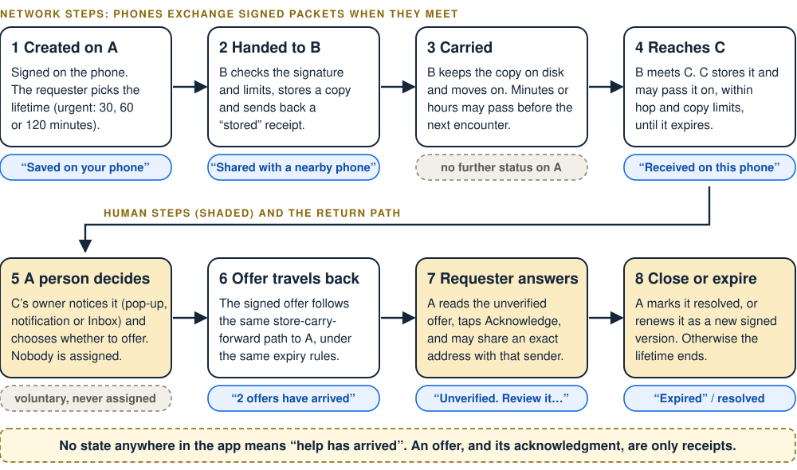
  <figcaption><b>Figure A. One request, end to end.</b> The loop Relay is built around: a need is created, carried across phones, noticed by a person, answered and acknowledged. Quoted labels are strings the app really shows. This is a mechanism diagram, not a measured result.</figcaption>
</figure>

<!--page:Scenarios and navigation-->
# 3. Scenarios and information architecture

<figure class="wide" markdown="0">
  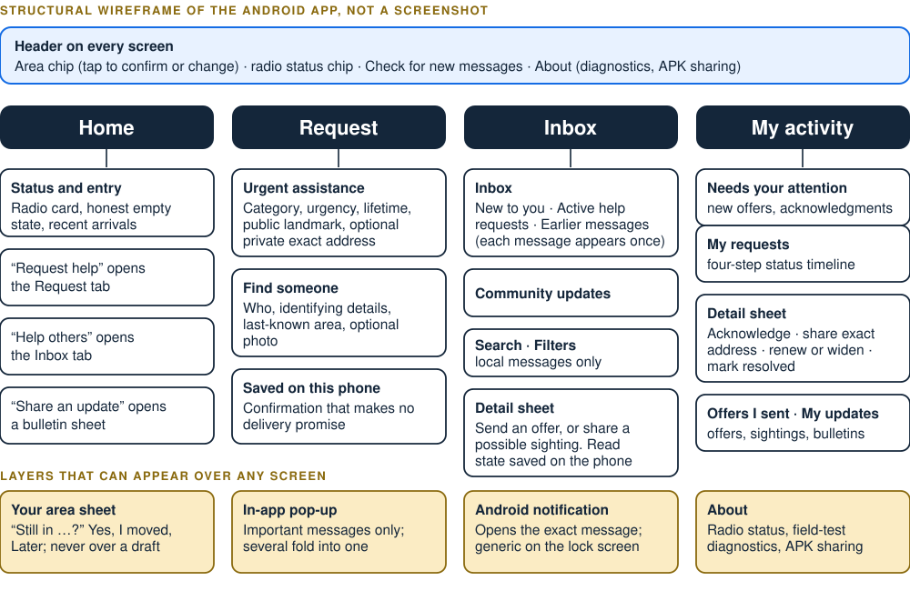
  <figcaption><b>Figure B. Structural wireframe</b> of the Android app (not a screenshot). Four tabs, two creation forms, sheets for detail, and layers that interrupt only when it matters.</figcaption>
</figure>

### Why the app is split this way

- **Request and Inbox are separate tabs** because in a crisis a person is usually either asking or helping, and each needs a different first screen.
- **My activity exists for follow-up.** Everything I created or answered, with its status, and a “Needs your attention” group so a new offer is not buried.
- **Community updates live inside Inbox, not on the tab bar,** so they stay secondary to emergencies.
- **One routine opens every message** (card, search result, pop-up, notification, My activity), so each route lands on the exact message.

### Why the header carries area and radio status

The area chip is the only location input the app has. The radio chip tells the user what the phone can honestly do right now (see section 4). Both sit on every screen because both change what a message can achieve.

| Scenario | Goal and pain | What the person does | What Relay does | Honest outcome |
|---|---|---|---|---|
| **Urgent help** | Needs a medical helper; does not know one | Fills the request form, saves | Stores it signed, offers it to each phone it meets, floods within hop and lifetime limits | “Saved”, then “Shared with a nearby phone” after a peer confirms storage |
| **Missing person** | Wants leads from people near the last-known place | Describes the person, picks the area, optionally adds a photo | Steers copies toward that area with bounded detours; sends the photo after the text | Sightings arrive as *unverified* possible sightings |
| **Community update** | Share water or safety news | Writes up to 280 characters | Floods at lowest priority for 45 minutes | Readable without replying; expires |
| **Reply and acknowledge** | Helper wants to offer; requester wants to choose | Helper sends an offer; requester acknowledges, may share address | Returns signed packets along the same carry path | An acknowledgment is a receipt, not acceptance or arrival |
| **Carrier** | Wants to help without writing anything | Keeps Relay running | Stores and forwards eligible packets | Never shown as delivery |

<!--page:Screens 1-->
# 4. Screens (1 of 4): where you are, and honest status

  <figure>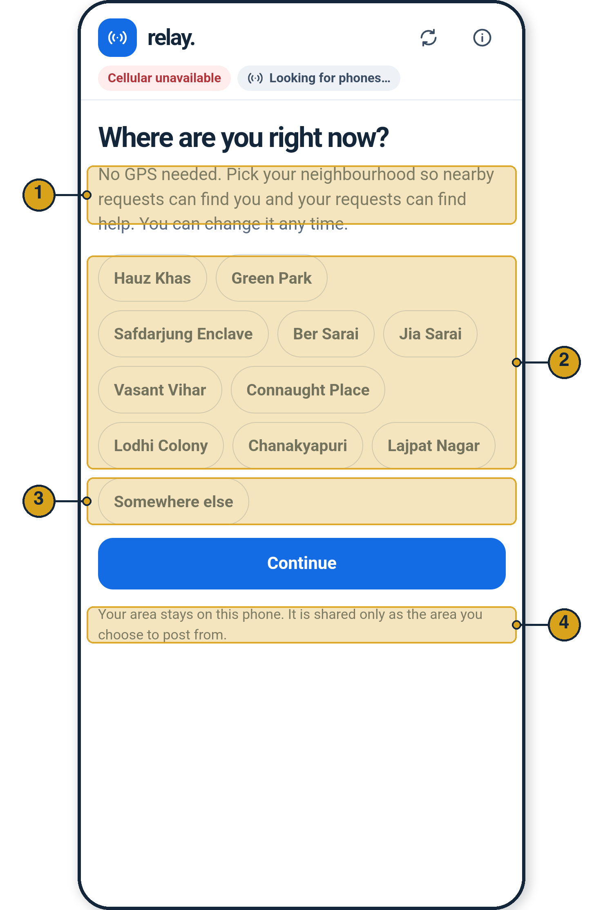<figcaption><b>Screen 1. First launch.</b> As-built, annotated.</figcaption></figure>
  <figure>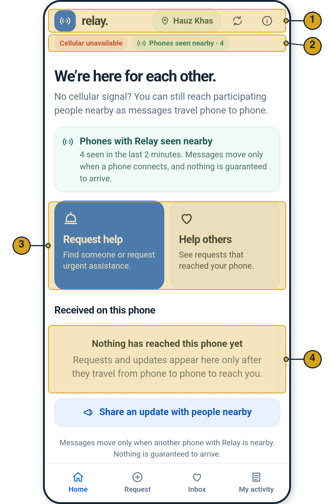<figcaption><b>Screen 2. Home.</b> As-built, annotated. <i>Staged:</i> “4 phones” was injected by a test hook; the emulator has no Bluetooth neighbours.</figcaption></figure>

| # | Element | Decision it carries |
|---|---|---|
| 1 | “No GPS needed” | Location is **declared, not sensed**. It works with no GPS and nothing to track. |
| 2 | Ten neighbourhoods | A small fixed offline graph (ten illustrative Delhi areas) later used for relevance and routing. |
| 3 | “Somewhere else” | Free text still works for local feeds but cannot steer missing-person routing. Stated on screen. |
| 4 | “Stays on this phone” | The area is shared only as the area you post from. |

| # | Element | Decision it carries |
|---|---|---|
| 1 | Area chip | One tap to confirm or change. After 60 minutes unconfirmed, routing treats it as unknown. |
| 2 | Radio status | Honest states: radio off, Bluetooth off, paused, looking, phones seen in the last 2 minutes. |
| 3 | Two entry points | **Request help** (I need) versus **Help others** (what reached my phone). |
| 4 | Empty state | “Nothing has reached this phone yet.” The app never implies a city-wide view. |

**States and edge cases.** Radio status has five failure and idle states: *No Bluetooth LE*, *Relay radio off · tap* (permission missing), *Bluetooth is off · tap*, *Relay paused · tap*, *Looking for phones…*. A phone that cannot advertise says it can look for others but cannot be found by them. Without a radio the app still creates, stores and reads messages; nothing is ever queued as “sent”. The Android 11-and-older location permission is needed only because those versions tie scanning to it; Relay does not read location.

<figure class="strip">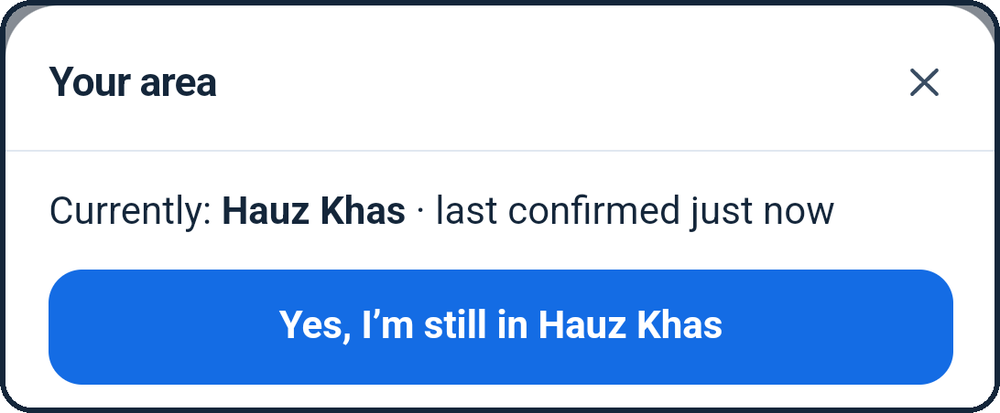<figcaption>As-built crop of the “Your area” sheet opened from the area chip: confirm, or move.</figcaption></figure>

**Why declared location.** GPS cannot be assumed, and a declared neighbourhood is coarse enough to steer by without implying precision. The cost is that people may declare it wrongly or forget to update it, so the app asks again: a compact “Still in …?” prompt about every 30 minutes (screen 5), and after 60 minutes unconfirmed the area counts as unknown for routing. Confirming or moving takes one tap.

<!--page:Screens 2-->
# 5. Screens (2 of 4): creating a request

  <figure>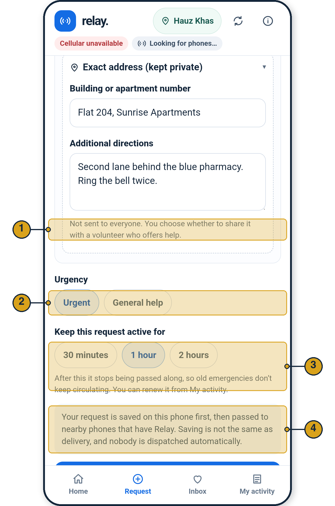<figcaption><b>Screen 3. Urgent assistance form</b> (lower half; category and description sit above). As-built, annotated.</figcaption></figure>
  <figure>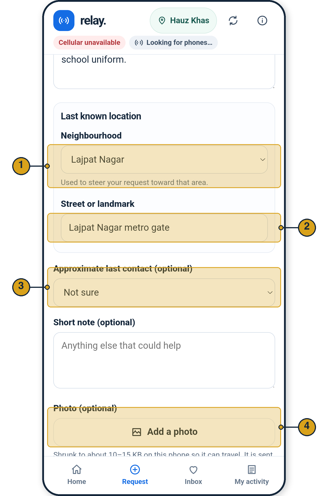<figcaption><b>Screen 4. Find someone form</b> (upper half). As-built, annotated.</figcaption></figure>

| # | Element | Decision it carries |
|---|---|---|
| 1 | Exact address (kept private) | Public text says where to look; the exact flat and directions stay on this phone until the requester shares them with one chosen helper. |
| 2 | Urgent or General | Urgent outranks everything else on the radio. |
| 3 | Active for 30 min / 1 h / 2 h | The requester sets a lifetime so old emergencies stop circulating; it can be renewed. |
| 4 | “Saved on this phone first” | Honest confirmation. Saving is not delivery, and nobody is dispatched. |

| # | Element | Decision it carries |
|---|---|---|
| 1 | Last-known neighbourhood | “Used to steer your request toward that area.” This is the routing target (section 9). |
| 2 | Street or landmark | Public, so a reader can place it. |
| 3 | Approximate last contact | Optional context; never required. |
| 4 | Photo (optional) | One compressed photo; sent after the text. |

<figure class="strip">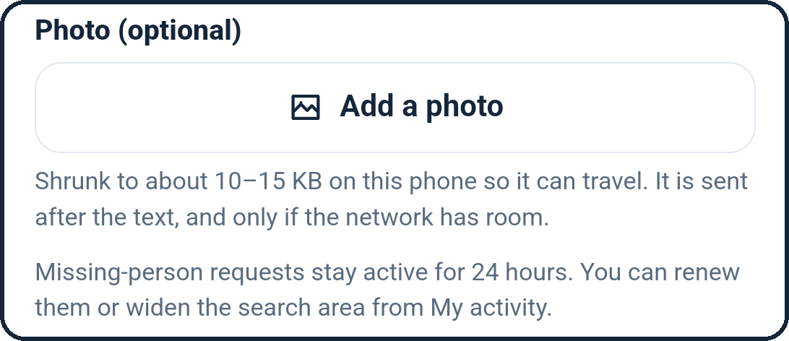<figcaption>As-built crop of the same form: photo and 24-hour copy.</figcaption></figure>

**Why photos are small and late.** Images are shrunk on the phone to about 10 to 15 KB (hard cap 32 KB, JPEG) because every byte competes with urgent text for scarce BLE airtime. The photo is sent after the text and only when there is room, so a request is never held up by its picture. Missing-person reports last 24 hours and can be renewed or widened.

**Request rules that matter.** Categories: Medical, Rescue, Food & water, Shelter, Other. The app builds the title from the category and landmark (“Medical help needed near Hauz Khas Metro, Gate 2”); description is limited to 240 characters. Urgent lifetimes are 30, 60 or 120 minutes; general requests up to 6 hours; missing-person reports 24 hours. Saving works with Bluetooth off.

<!--page:Screens 3-->
# 6. Screens (3 of 4): receiving, noticing and offering

  <figure>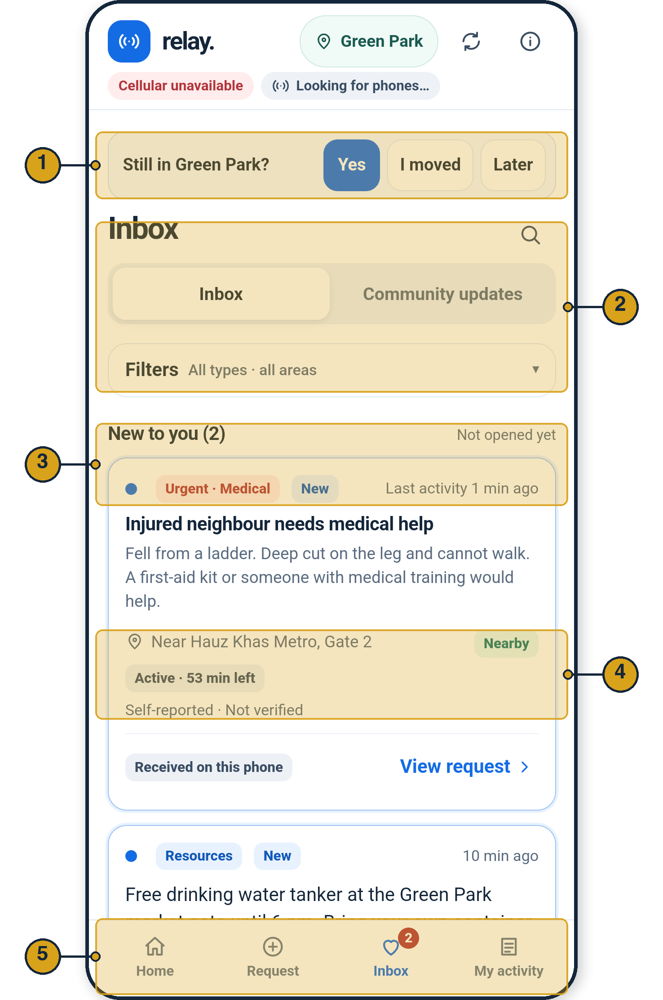<figcaption><b>Screen 5. Inbox.</b> A different phone (declared area Green Park). As-built, annotated. <i>Staged:</i> messages were delivered by a test fixture as real signed packets.</figcaption></figure>
  <figure>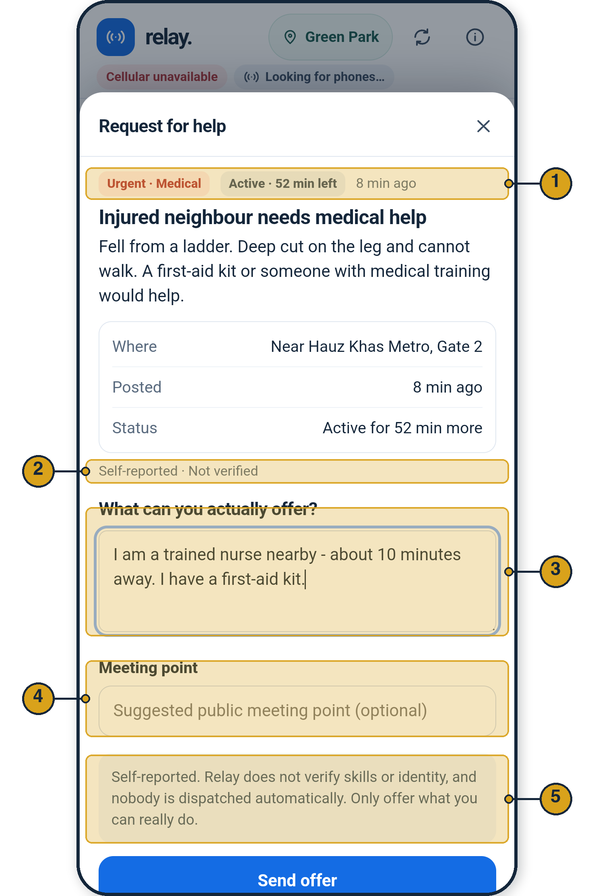<figcaption><b>Screen 6. Request detail and offer.</b> As-built, annotated. The offer text was typed into the real field.</figcaption></figure>

| # | Element | Decision it carries |
|---|---|---|
| 1 | “Still in Green Park?” | Reconfirms the declared area about every 30 minutes; never interrupts a half-written form. |
| 2 | Search, tabs, filters | Local search over messages stored on this phone only: “Relay can only search messages that have reached this phone.” |
| 3 | New to you + unread dot | Each message appears in one group (New / Active / Updates / Earlier). Read state persists and sends nothing. |
| 4 | Nearby · Active · Self-reported | Relevance (declared area within one step), time left, and an honest trust label. |
| 5 | Badges | Inbox and My activity show counts so unseen items stay visible. |

| # | Element | Decision it carries |
|---|---|---|
| 1 | Time left and age | Remaining lifetime is carried hop by hop, so a helper sees how long it is still worth acting. |
| 2 | Self-reported · Not verified | The sender’s claims are never presented as fact. |
| 3 | “What can you actually offer?” | A free-text, voluntary offer. Nobody is assigned automatically. |
| 4 | Meeting point (optional) | Suggests a *public* place, so no address is needed to start. |
| 5 | Verification disclaimer | “Relay does not verify skills or identity.” |

<figure class="strip">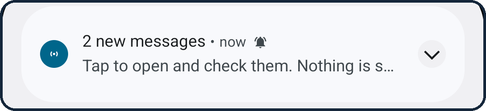<figcaption>As-built Android notification shade (emulator capture from the repository’s final-polish set): several arrivals fold into one.</figcaption></figure>

**Notifications.** One new message gets its own notification that opens that exact message; two or more become a single “N new messages” notification. The lock screen shows only generic text.

**What is allowed to interrupt.** Decided on the phone from the packet and the declared area, with no server:

- **Important:** a response to my request; an acknowledgment of my offer; an urgent or missing-person request in my area or one step away.
- **Not important:** everything else. It appears in Inbox and the badge, never as a pop-up.

Human attention is scarce, so the rule favours what a neighbour can act on.

<!--page:Screens 4-->
# 7. Screens (4 of 4): closing the loop

  <figure>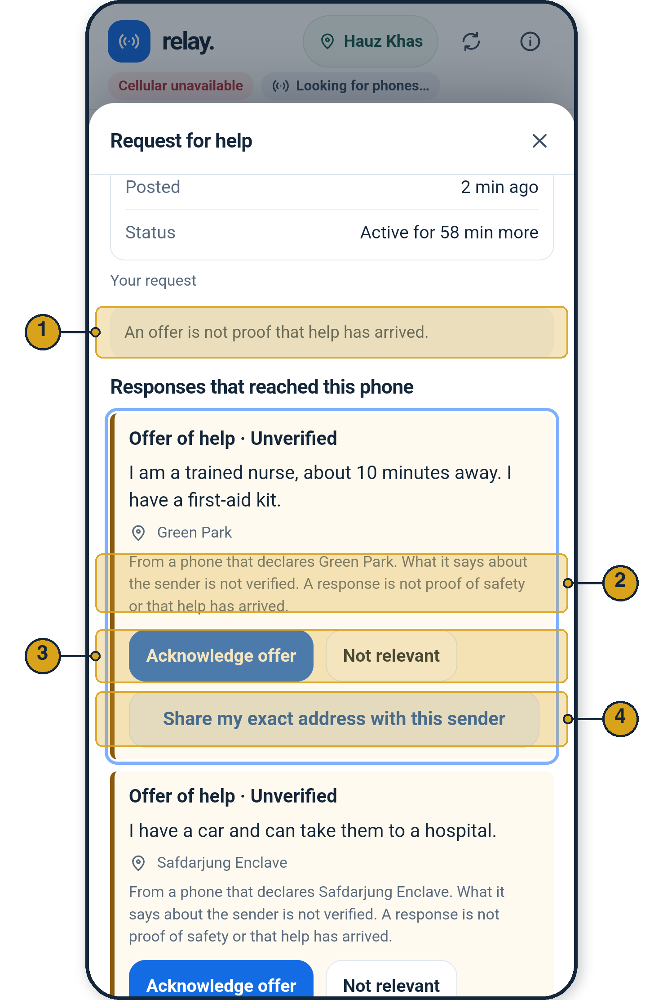<figcaption><b>Screen 7. Responses (requester’s phone).</b> As-built, annotated. <i>Staged:</i> two offers delivered by a test fixture.</figcaption></figure>
  <figure>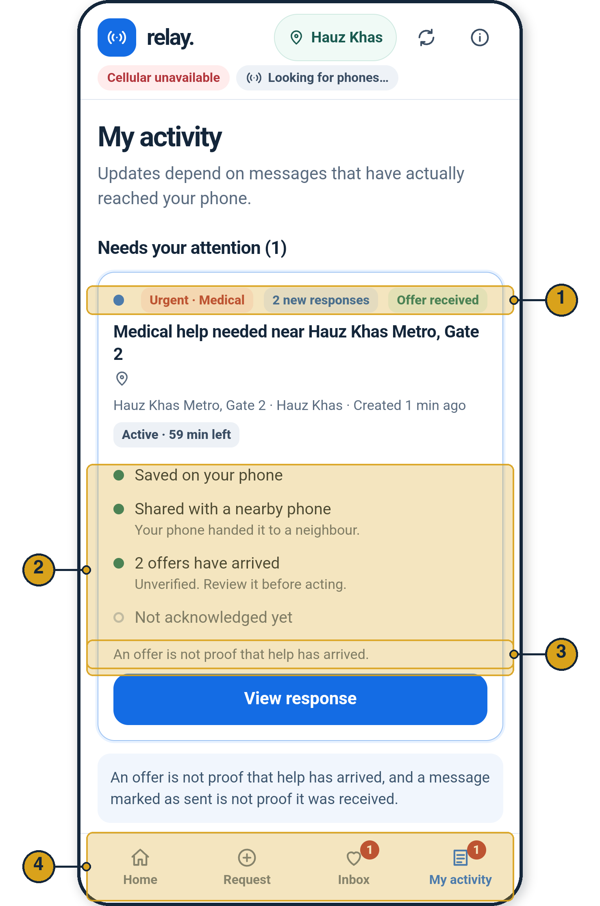<figcaption><b>Screen 8. My activity.</b> As-built, annotated. <i>Staged:</i> “Shared with a nearby phone” came from a real link session between the app and an in-memory peer.</figcaption></figure>

| # | Element | Decision it carries |
|---|---|---|
| 1 | “An offer is not proof that help has arrived” | States the limit of the product in the place it matters. |
| 2 | “Unverified” + declared area | Shows only the area the sender declared. It does not claim they are nearby, qualified or a volunteer. |
| 3 | Acknowledge · Not relevant | Acknowledging confirms the offer was received. It is not acceptance and sends no automatic read receipt. |
| 4 | Share my exact address | Seals the address to **this one sender’s key**; carriers hold ciphertext they cannot read. |

| # | Element | Decision it carries |
|---|---|---|
| 1 | Status chips | Category, “2 new responses”, “Offer received” in one glance. |
| 2 | Four-step timeline | Saved on your phone → Shared with a nearby phone → N offers arrived → Acknowledged. “Shared” appears only after a peer’s *stored* receipt. |
| 3 | Reminder line | Repeats the limit at the moment of decision. |
| 4 | Badges | Needs-attention counts, kept across app restarts. |

<figure class="strip">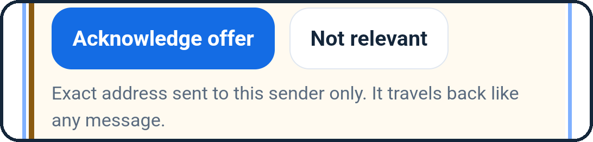<figcaption>As-built crop after tapping Share: “Exact address sent to this sender only. It travels back like any message.”</figcaption></figure>

<figure class="strip">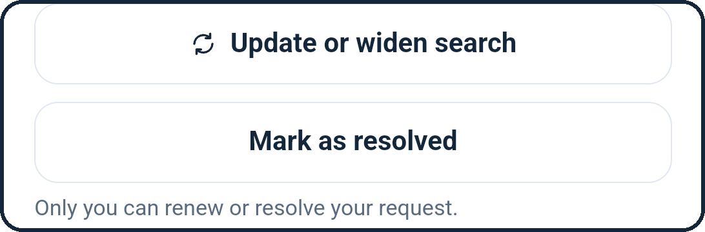<figcaption>As-built crop of a request’s lower half (a missing-person case): widen or renew, mark resolved, owner-only.</figcaption></figure>

**Lifecycle controls.** The requester can **renew** (a new signed version that replaces the old one), **widen** the search, or **mark resolved**. Only the key holder who created the request can renew or resolve it, so strangers cannot extend or close someone else’s need. A renewal that only extends time keeps the earlier read state; one that changes the words becomes unread again.

**What cannot be inferred.** These screens prove the interface and the engine. They do not show a real Bluetooth exchange between two phones, a rescue, or any delivery rate.

<!--page:Features-->
# 8. Capabilities and functional requirements

Grouped from the full feature inventory into twelve capabilities. Status uses the evidence tags from section 1. Acceptance criteria are given only where they expose a real decision.

| ID | Capability | Problem it addresses | How it works (one line) | Trade-off accepted | Status |
|---|---|---|---|---|---|
| F1 | Declared area and reconfirmation | No GPS; locations go stale | Pick one of ten areas or free text; prompt about every 30 min; unconfirmed after 60 min is treated as unknown for routing | People may forget or mis-declare | IMPL TESTED |
| F2 | Structured urgent / general requests | An unknown helper must understand the need | Category, urgency, public landmark, lifetime; title is generated; signed on the phone | Less expressive than free chat | IMPL TESTED |
| F3 | Missing-person report and sightings | Find people without their phone | Description, last-known area as routing target, 24 h life; replies are *unverified possible sightings* | False leads are possible | IMPL TESTED |
| F4 | Optional photo | Faces help recognition | Shrunk to about 10–15 KB, ≤ 32 KB JPEG, chunked, SHA-256 verified, sent after text at lowest priority | Photo delivery is slow and may never arrive | IMPL radio transfer untested |
| F5 | Community updates | Local information without chatter | ≤ 280 characters; Community, Safety information, Resources, Check-in; 45 min; lowest priority | Cannot crowd out emergencies, so may travel less | IMPL TESTED |
| F6 | Inbox, search, read state, refresh | A message must be noticed, then found again | Grouped Inbox, local search, durable unread flag, refresh that counts only stored packets | Search covers only what this phone holds | IMPL TESTED |
| F7 | Notifications | Attention is scarce | Important-only pop-ups; one notification per message, folded into “N new messages” | Some relevant items arrive silently | IMPL TESTED |
| F8 | Offer, acknowledge, renew, resolve | Close the loop without false certainty | Signed reply, ack, resolve and renewal packets; only the owner key can renew or resolve | Acknowledgment is only a receipt | IMPL TESTED |
| F9 | Exact-address sharing | Help needs a precise location; broadcasting it is unsafe | Sealed to one volunteer’s key after the requester chooses | Extra steps; address stored unencrypted on requester’s phone | IMPL TESTED |
| F10 | Radio status and diagnostics | Users must know what the phone can do | Honest status chip, permission and Bluetooth states, field-test diagnostics | Technical detail kept in About | IMPL TESTED |
| F11 | Offline app sharing | Growth without app stores | “Share this app with a nearby person” sends the APK file; installer consent required | Sideloading adds trust friction | IMPL install flow unverified |
| F12 | Storage, expiry, deduplication | Phones are small and the network is noisy | Packet ID is a hash of the signed body; up to 500 packets; expired and lowest priority evicted first | Old items disappear by design | IMPL TESTED |

### Small decisions that carry weight

| Decision | Why | Acceptance criterion |
|---|---|---|
| One copy per request in the Inbox | A renewed or answered request must not appear twice | Every message is in exactly one group |
| Reading sends nothing | A read receipt would leak behaviour and burn airtime | Opening a message creates no packet |
| Acknowledge ≠ accept | The requester may receive several offers | Ack text says it confirms receipt only |
| Drafts survive refresh and pop-ups | A person writing under stress must not lose text | Refresh keeps forms, search text, filters |
| Unread active ranks above expired | Time-critical items first | An expired unread item stays in *New to you*, labelled |
| Refresh invents nothing | “N new messages” counts stored packets only | “Nothing new has arrived” when none did |

<!--page:Networking-->
# 9. Offline networking: how it actually works

All of this section describes the **Android implementation** (Kotlin BLE engine, SQLite store, foreground service), not the desktop simulator. Relay uses its own application-level store-carry-forward protocol over BLE GATT. It is **not** the Bluetooth SIG Mesh profile.

<figure class="wide" markdown="0">
  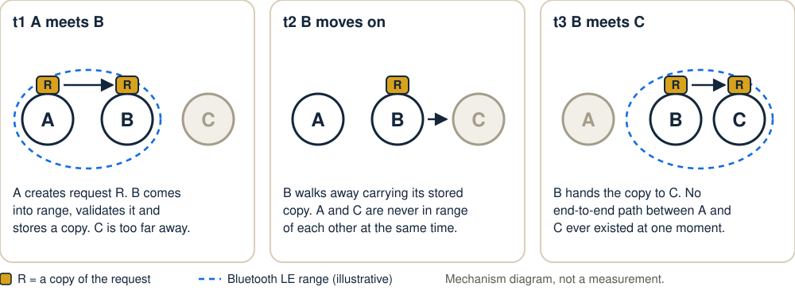
  <figcaption><b>Figure C. Store, carry, forward.</b> A and C never meet, yet R can reach C because B stored it and later met C. Each hand-off happens only at an encounter, so delivery needs patience and enough participants.</figcaption>
</figure>

### Discovery and exchange

- Every phone runs a **GATT server** and, if the chip allows, **advertises** one service plus a 6-byte tag (a device tag that rotates hourly, and a 2-byte digest of what it holds).
- It **scans** in 10 s windows every 60 s in low-power mode. A new local post opens a burst: a 10 s low-latency window every 20 s for 3 minutes. Scan starts stay 8 s or more apart because Android throttles above 5 starts per 30 s.
- The phone with the smaller tag **dials**; a phone that cannot advertise always dials. At most **2 sessions** at once, a 60 s cooldown per peer (10 s when we have news), failure back-off from 15 s to 10 minutes. No connection when neither side’s inventory changed.
- A session runs **HELLO → INV → WANT → PKT → PACK**. Only the receiver’s PACK (“stored”) may be shown as “Shared with a nearby phone”.

### Why this transport

Native BLE GATT was chosen over Google’s Nearby Connections because it needs **no Play services**, uses only Bluetooth LE (so the claim is accurate) and gives full control of discovery and back-off. The cost is low throughput (about 10–100 kB/s in practice, fine for text and 15 KB photos) and per-phone quirks.

**Limits that are real.** Background relaying is not guaranteed: Doze, battery savers and OEM task killers can stop the foreground service. There is no restart after reboot. Two phones that both cannot advertise never find each other.

### Forwarding policy by message type (from `Policy.kt`, `Limits.kt`, `Validation.kt`)

| Message | Policy | Hops · copies | Priority · lifetime |
|---|---|---|---|
| Urgent or general request, reply, acknowledgment, resolve, address | **Flood** to any eligible peer | 60 hops | Urgent first. Urgent ≤ 120 min, general ≤ 360 min, replies ≤ 120 min |
| Missing-person report with a target area | **Directed**: offer to peers in or closer to the target area (graph distance, not GPS), then bounded detours | 40 hops; 3 copies toward the target; 1 detour (up to 3 once a copy has waited 16 min); detours wait 3 min | Normal. 24 h |
| Missing-person report with no valid area | **Opportunistic** | 10 hops; 3 copies | Normal |
| Community update | **Flood** | 30 hops | Lowest. 45 min (max 60) |
| Photo bytes | Follow the request’s route | Chunks of 1 KB, resumable | Lowest, after text |

Each hop forwards the **remaining lifetime**, not a clock time, and the receiver sets its own expiry, so wrong clocks cannot extend a message. Peers with a declared area older than 60 minutes count as unknown for directed routing. Directed routing can fail if people declare wrong areas, which is why detours exist. **Nothing here guarantees that a message reaches a particular person.** A stored copy is dropped 30 minutes after expiry unless it involves this phone.

<!--page:Privacy and decisions-->
# 10. Privacy, security and the decisions behind them

### What is protected

| Property | How |
|---|---|
| Authenticity, integrity | Every packet is Ed25519-signed; its ID is a hash of the signed body, so tampering changes the ID |
| Case ownership | Only the key holder can create, renew, resolve or acknowledge for a case |
| Exact address | Encrypted to **one** volunteer’s key (X25519, HKDF, AES-256-GCM) and signed; carriers see ciphertext |
| Keys at rest | Wrapped by Android Keystore; cloud backup off |
| No network leak | The app declares **no INTERNET permission** |
| Abuse bounds | Size and hop limits, 30 packets per hour per key, session budgets |

### What is not protected

- **Request text, photos, areas and community posts are readable** by any phone that carries them. Relay is not end-to-end encrypted.
- **Pseudonymous, not anonymous.** One key signs all of a phone’s packets, and the declared area is in each request.
- **Radio metadata** is visible to nearby phones; the exact address is stored unencrypted on the requester’s phone.
- **No identity checks.** Skills and sightings are self-reported; a malicious phone can post falsehoods within its rate limit, and many keys can still flood.
- **The sealed-address design is a custom composition of audited primitives and has not been reviewed by a cryptographer.** There is no independent security audit.

### Decision register

| # | Decision | Alternatives | Chosen, and the cost accepted | Revisit if |
|---|---|---|---|---|
| 1 | What the product carries | Open chat; broadcast feed | **Structured, expiring requests with replies.** Less expressive, but findable by unknown helpers | Users cannot describe needs in the form |
| 2 | Transport | Nearby Connections (Wi-Fi, Play services) | **Native BLE GATT.** Lower speed and more phone quirks, but no Google dependency | Field tests show unacceptable reliability |
| 3 | Location | GPS; city map | **Declared neighbourhood, ten-area graph.** Coarse and manual, but works offline and claims no precision | Wrong areas cause missed deliveries |
| 4 | Forwarding | One rule for everything | **Flood, directed or opportunistic by type.** More rules to explain | Copies cost more than they return |
| 5 | Delivery language | “Delivered” ticks | **Only what a peer confirmed.** Less reassuring, more honest | Users misread the states |
| 6 | Address sharing | Put it in the request | **Seal to one volunteer after an explicit tap.** Extra steps in an emergency | Testing shows it delays help |
| 7 | Lifetime | Keep until deleted | **Expiry, renewal, resolve.** A real need may outlast its lifetime | Renewal proves too burdensome |
| 8 | App structure | Fully native UI | **Native engine with a bundled WebView UI.** Keeps one reviewed design; needs a bridge | UI performance or parity issues |

### Where documents and code disagree (the code wins)

| Topic | Documents say | Code and reports show |
|---|---|---|
| Burst scanning | Transport ADR: 30 s windows every 20 s for the first minute | 10 s windows every 20 s for 3 minutes after new local data |
| Physical testing | `LIMITATIONS.md`, `QA_REPORT.md`: none done | The team reports it has worked on physical phones; no record exists |
| Test counts | QA report: 93 JVM, 18 instrumented | Final-polish notes: 108 JVM, 28 instrumented |
| Sighting label | n/a | Detail sheet says “Offer of help” for a sighting |
| Code layout | `ARCHITECTURE.md` lists planned file names | Actual core files differ (for example `Bytes`, `Crypto`, `Framing`, `Link`) |

<!--page:Assumptions-->
# 11. Assumptions, validation and measures

### Evidence ladder

| Level | What exists |
|---|---|
| TESTED | Kotlin JVM tests (108 passing at the final-polish commit), 28 emulator instrumented tests (0 failed, 1 manual fixture skipped), Android-adapter UI suites at several widths, lint, APK checks |
| TEAM-REPORTED | The team reports the app has worked on **physical phones**. The number, models, settings, timings and logs are **not on record**. |
| NOT YET | Three-phone multi-hop on real radios; mixed phone brands; background and battery behaviour; photo transfer over the radio; city-scale density; user research |

**Source conflict, recorded.** Earlier docs (`LIMITATIONS.md`, `QA_REPORT.md`) state that no physical radio testing had been done. The team has since reported success on real phones, but reports differ on how many (two in the case handoff, more in a later statement) and none is documented. This appendix therefore treats it as team-reported, with no device count or results quoted, until logs exist.

### Assumption register (highest-risk first)

| Assumption | If it is false | Practical validation |
|---|---|---|
| **Enough phones meet before a request expires** | One hop works but a helper is rarely reached | Controlled density trials with 3, 5 and 10+ phones; delivery against expiry |
| **A relevant person chooses to answer** | Perfect delivery, zero help | Small volunteer study: offer rate and time to first offer |
| BLE works across Android makes and OS versions | Sessions fail; messages stay queued | Repeated pair tests on mixed hardware, lock states, restarts |
| People keep Relay running despite battery cost | Carrying capacity far below install count | Battery and retention logging under realistic use |
| Declared areas are accurate enough | Directed routing misses; detours waste copies | Replay with injected area errors; compare to flooding |
| Users read *saved*, *shared*, *offer* and *acknowledged* as different | False certainty about rescue | Scenario comprehension tests of the wording |
| False sightings or claims stay manageable | Harm and loss of trust | Usability tests with ambiguous leads; threat model; security review |

### Proposed measures (none measured yet)

| Layer | Measure |
|---|---|
| Technical reliability | Successful phone-to-phone exchanges; connection success by model; battery use per hour |
| Message delivery | Multi-hop delivery in controlled tests; time to first relevant receipt; copies and bytes per helper reached |
| Human engagement | Share of received urgent requests opened; time to first relevant response; share of replies acknowledged; share of users able to find an earlier message |
| Coordination value (north star) | Share of time-critical requests that get a **relevant, acknowledged response** in an acceptable window, by need type. The window needs research; it is not rescue. |

### References (design context, not evidence about Relay)

1. V. Cerf et al., *Delay-Tolerant Networking Architecture*, RFC 4838, 2007. <https://www.rfc-editor.org/rfc/rfc4838.html>
2. A. Vahdat and D. Becker, *Epidemic Routing for Partially Connected Ad Hoc Networks*, Duke Univ. tech. report, 2000. <https://cseweb.ucsd.edu/~vahdat/papers/epidemic.pdf>
3. T. Spyropoulos, K. Psounis, C. Raghavendra, *Spray and Wait*, ACM SIGCOMM Workshop on DTN, 2005. <https://doi.org/10.1145/1080139.1080143>
4. Bluetooth SIG, *Mesh Protocol* specification (named only to distinguish it from Relay). <https://www.bluetooth.com/specifications/specs/mesh-protocol/>
5. Android Developers, *Bluetooth permissions*. <https://developer.android.com/develop/connectivity/bluetooth/bt-permissions>
6. Android Developers, *Communicate in the background (BLE)*. <https://developer.android.com/develop/connectivity/bluetooth/ble/background>

These papers explain why store-carry-forward and bounded replication are reasonable. They do not show how Relay performs.
